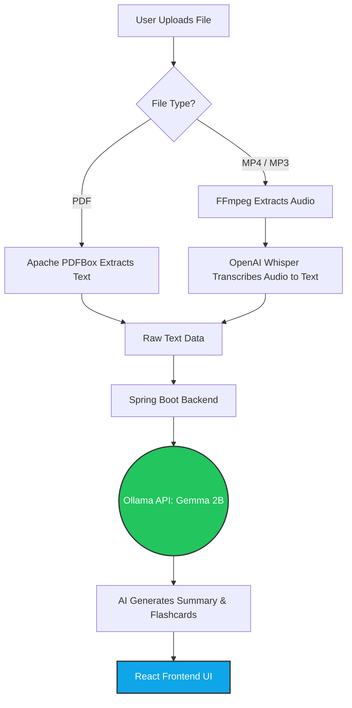

<div align="center">
  
  

  <h1>🦥 Lazy Student AI</h1>
  <p><strong>Let Local AI Do The Heavy Lifting. Turn Hours of Lectures into Flashcards & Summaries.</strong></p>
  

</div>

## 📌 About The Project

**Lazy Student AI** is a 100% offline, privacy-first desktop application built for students who want to study smarter, not harder. Submitted for **Hacktoberfest 2026 (Week 3: Slow and Steady)**, this tool takes your long, boring lecture videos (MP4), audio recordings (MP3), or massive PDF documents, and automatically generates bite-sized bullet-point summaries and interactive flashcards.

No cloud, no API keys, no subscription fees. It runs entirely on your local machine using open-weight models!

### ✨ Key Features
- **Multi-Format Support:** Drag and drop PDFs, MP3s, or MP4s.
- **Smart Summarization:** Powered by Google's Gemma 2B model.
- **Interactive Flashcards:** Automatically generates Q&A pairs for active recall.
- **100% Offline & Private:** Your data never leaves your laptop.
- **Standalone Desktop App:** Packaged as a clean `.exe` for Windows.

---

## 🛠️ Tech Stack

*   **Frontend:** React 18, Vite, Tailwind CSS v4, Framer Motion
*   **Backend:** Spring Boot 3 (Java 17), SQLite
*   **AI Models & Tools:** 
    *   [Ollama](https://ollama.com/) (running **Gemma:2b**)
    *   [OpenAI Whisper](https://github.com/openai/whisper) (for speech-to-text)
    *   FFmpeg (for audio extraction)
*   **Packaging:** Launch4j, Inno Setup

---

## 📐 System Architecture

Here is how the data flows through the application locally:



---

## 🚀 Getting Started (Installation)

Since this is a local AI tool, you need to set up your environment before running the application.

### Prerequisites

1.  **Java 17** installed.
2.  **Node.js** (for frontend development).
3.  **Python 3.9+** (for Whisper AI).

### Step 1: Install AI Models & Dependencies

Open your Command Prompt (Admin) and install the following:

**1. Install Ollama & Gemma**
Download Ollama from [ollama.com](https://ollama.com/), install it, and run:
```bash
ollama run gemma:2b
```

**2. Install FFmpeg & Whisper**
```bash
winget install ffmpeg
pip install -U openai-whisper
```
*(Note: Restart your terminal/IDE after installing FFmpeg)*

### Step 2: Clone and Setup the Project

```bash
# Clone the repository
git clone https://github.com/shan2003034/lazy-student-ai-summarizer.git
cd lazy-student-ai-summarizer
```

**Frontend Setup:**
```bash
cd frontend
npm install
npm run dev
```

**Backend Setup:**
Open the project in IntelliJ IDEA (or your favorite IDE) and run the Spring Boot application (`LazyStudentAiApplication.java`).

---

## 📦 Building the `.exe` (For Production)

If you want to build the standalone desktop application yourself:

1.  **Build the Frontend:** Run `npm run build` in the React project.
2.  **Merge with Backend:** Copy all contents from the generated `dist` folder and paste them into `src/main/resources/static/` in your Spring Boot project.
3.  **Create JAR:** Run `mvn clean package` to generate the `.jar` file.
4.  **Create EXE:** Use **Launch4j** to wrap the `.jar` into an `.exe` (Set Min JRE to 17).
5.  **Create Installer:** Use **Inno Setup** to compile the `.exe` into a professional Windows Installer.

---

## 💡 How to Use

1.  Open **Lazy Student AI** from your desktop.
2.  Click **Upload** and select your Lecture (`.mp4`, `.mp3`, or `.pdf`).
3.  Wait while the terminal shows the background progress (FFmpeg → Whisper → Gemma).
4.  Read the generated **Summary** and use the **Flashcards** tab to test your knowledge!

---

## 🤝 Contributing

Contributions make the open-source community an amazing place! Since this is a Hacktoberfest project, PRs are highly welcome.

1. Fork the Project
2. Create your Feature Branch (`git checkout -b feature/AmazingFeature`)
3. Commit your Changes (`git commit -m 'Add some AmazingFeature'`)
4. Push to the Branch (`git push origin feature/AmazingFeature`)
5. Open a Pull Request

---

## 📄 License

Distributed under the MIT License. See `LICENSE` for more information.

## 👨‍💻 Author
 
**Prasanna Lakshan**
 
- 🌐 Portfolio: [https://prasanna-lakshan.vercel.app/](https://prasanna-lakshan.vercel.app/)
- 💼 LinkedIn: [https://www.linkedin.com/in/prasannalakshan](https://www.linkedin.com/in/prasannalakshan)
- 🐙 GitHub: [https://github.com/shan2003034](https://github.com/shan2003034)

</div>
